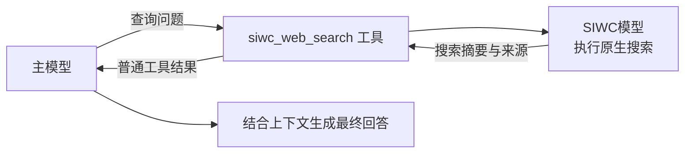

# Sign in with ChatGPT

> [!WARNING]
> 本项目为个人插件，目前仅在 Windows / AstrBot Desktop 上测试过，不保证在其他环境下稳定运行。

> [!IMPORTANT]
> 需要至少 AstrBot 4.29.1

本项目是面向 Windows / AstrBot 4.29.1 的 AstrBot 插件，通过 Sign in with ChatGPT (SIWC) 官方接口授权接入 ChatGPT 订阅模型。

支持文字、图片输入、函数工具往返、流式响应和可选的独立网页搜索工具。暂不支持音频、视频、文件上传及生图。

## 安装与授权

1. 在 AstrBot 插件页通过本插件的 GitHub 仓库地址安装，并保持插件启用。已有绑定可直接复用。
2. 打开本插件的视图页面，点击 **Continue with ChatGPT**，在 AstrBot 所在电脑的系统浏览器完成授权。
3. 等待管理页显示“已连接”；登录阶段和倒计时显示在连接状态区域。授权过程中，同一按钮显示“取消授权”；已有绑定时显示“重新授权”。收到浏览器回调时仍可能正在验证，关闭或刷新页面不会取消后台授权。
4. 在 AstrBot 模型页面添加“Sign in with ChatGPT”提供商源，新建源的默认 ID 为 `SIWC`。选择账号可用模型，Key 保持 `siwc-managed-no-api-key` 占位值。管理页可以刷新模型列表；模型测试使用 AstrBot 供应商配置页的功能。

管理页也提供重新授权和解绑。重新授权期间暂停新的本账号模型请求；失败或取消会保留原有效绑定。

## 账号与用量工作台

视图页面显示绑定邮箱、账号状态、可用模型及本插件最近 30 天的用量。界面随 AstrBot 切换亮暗主题，并适配窄屏。

- 首次成功授权后，弹窗说明符合条件的 AI 请求会使用 ChatGPT 套餐用量；点击“知道了”后在本地保存确认状态，之后登录不重复提示。
- 用量概览包含请求数、成功／失败／取消次数、输入和输出 token、缓存输入、平均耗时、每日请求趋势、模型分布与最近请求。
- 统计按 UTC 自然日保留最近 30 天，最近请求最多保留 100 条；仅统计通过本插件 Provider 发起的对话与独立搜索请求，不包含其他应用。
- token 数仅累计服务端实际返回的字段；请求中断、取消或响应未返回用量时，消耗未知。
- **Manage usage** 打开[ChatGPT 用量设置](https://chatgpt.com/settings/usage)，用于查看实际套餐用量、积分与应用限额。

统计保存在插件私有数据目录的 `usage.json`，与凭据分开存储，不会记录提示词、回复、搜索词或令牌。

首次使用告知和用量管理入口参考自[OpenAI SIWC 界面指南](https://developers.openai.com/siwc/ui-ux-guidelines)。

## 独立网页搜索工具(beta)

> [!NOTE] 
> 实际上，SIWC 接口支持直接使用OpenAI模型的原生搜索，但这会导致返回的内容必然引用搜索结果的网址。  
> 因此，这个工具的本质是封装一层子代理来调用OpenAI模型的原生搜索。

1. 在 AstrBot 模型页面配置并启用一个 Sign in with ChatGPT 提供的模型，确认账号已绑定。
2. 在插件设置的“网页搜索”分组中选择“搜索模型”，开启“启用搜索工具”；“供应商接入 → 启用供应商”也需保持开启。
3. 确保当前会话的主模型支持工具调用，并在 AstrBot 的工具/人设设置中允许使用 `siwc_web_search`。

工具结果包含 `ok`、`searched`、`search_count`、`summary`、`sources` 和 `truncated`；失败时返回 `ok: false` 与安全错误信息。来源中 `cited: true` 表示搜索摘要引用的来源，`false` 表示搜索过程返回的其他参考来源；来源按 URL 去重并最多保留 32 条。摘要可设置长度上限，默认 12000 字，超出后标记截断；摘要和来源中的链接会保留，主模型负责最终表述，不能保证回答完全无链接。使用 OpenAI 搜索结果时仍需遵循其[来源引用展示要求](https://developers.openai.com/api/docs/guides/tools-web-search#output-and-citations)。

搜索会额外消耗一次或多次模型推理及检索资源，可用性受所选模型和账号策略限制。

普通模型对话支持文本流式输出及 AstrBot 函数工具，OpenAI 原生搜索仅通过独立搜索工具调用。

## 开源许可

Copyright (C) 2026 ShrHang.

本项目采用 GNU Affero General Public License v3.0（`AGPL-3.0-only`），完整条款见 [LICENSE](LICENSE)。

本插件继承并复用 [AstrBot](https://github.com/AstrBotDevs/AstrBot) 的 Provider 和上下文处理能力。AstrBot 本体由其原作者及贡献者持有版权，采用 [AGPL-3.0](https://github.com/AstrBotDevs/AstrBot/blob/master/LICENSE)；本仓库不包含 AstrBot 本体。第三方依赖遵循各自的许可证。
